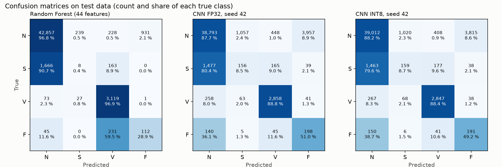
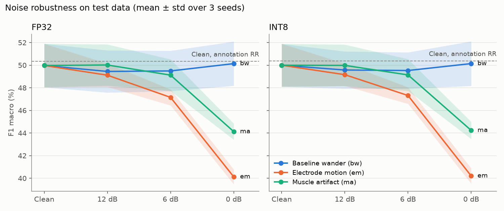

# Edge-Ready ECG Classification (MIT-BIH, MAX78002)

Beat classification of MIT-BIH ECG into the four AAMI classes N, S, V and F with a small 1D CNN that fits the MAX78002 CNN accelerator. Project in D7043E Advanced Data Mining (LTU), following CRISP-DM.

The final model is a CNN with three Conv1d layers (16, 32 and 64 filters) and RR intervals as two extra input channels: 16,228 parameters, about 16.6 kB in INT8. It was selected on validation macro F1 and evaluated once on the held-out test records (DS2).

## Results on the test records (DS2)

| Model | Macro F1 | Accuracy | Recall N / S / V / F (%) |
|---|---|---|---|
| Random Forest, 44 features (baseline) | 50.61 % | 92.75 % | 96.8 / 0.4 / 96.9 / 28.9 |
| CNN + RR, FP32 (mean of 3 seeds) | 50.34 ± 1.42 % | 84.55 % | 87.6 / 12.0 / 87.8 / 55.4 |
| CNN + RR, INT8 (mean of 3 seeds) | 50.38 ± 1.35 % | 85.06 % | 88.2 / 12.0 / 87.6 / 52.6 |

- INT8 quantization costs no accuracy (50.38 % against 50.34 % for FP32).
- The CNN matches the baseline in macro F1 on new patients, with lower accuracy but higher recall for S and F, and it is small enough for the MAX78002.
- Results vary a lot between patients: accuracy per record ranges from 22 % to 100 % (median 92 %). Record 232 alone holds 1,382 of the 1,837 S beats, and almost all of them are classified as N.

Full results: `results/metrics_test.csv`, `results/per_record_test.csv` and the confusion matrices below.



### Noise robustness

Noise from the MIT-BIH Noise Stress Test Database added to the test records at 12, 6 and 0 dB, with RR computed by a Pan-Tompkins detector in the noisy signal. INT8 model, mean of 3 seeds:

| | Macro F1 | Accuracy |
|---|---|---|
| Clean, RR from detector | 50.0 % | 84.4 % |
| Electrode motion (em), 0 dB | 40.2 % | 80.2 % |
| Muscle artifact (ma), 0 dB | 44.2 % | 81.7 % |
| Baseline wander (bw), all levels | 49.5–50.1 % | 84.1–84.6 % |

Full table: `results/noise_summary_test.md`.



### MAX78002 deployment

The same architecture was trained, quantized and synthesized to C code with Analog Devices ai8x-training and ai8x-synthesis. Verified in software only; no MAX78002 hardware was used, so no latency, power or on-device accuracy is claimed.

| Requirement | Result |
|---|---|
| Model accepted by MAX78002 toolchain | PASS |
| Quantization completed | PASS |
| Synthesis completed | PASS |
| C/device files generated | PASS |
| Weight memory | 16,228 bytes (limit 2 MB) |
| Data memory | about 3.2 kB (limit 1.3 MB) |

The model retrained with ai8x-training reaches a lower validation macro F1 (38.5 %) than the PyTorch model (51.7 %); see `max78002/deployment_evidence.md` and `max78002/ai8x_training/README.md`.

## Repository structure

```
README.md
requirements.txt
configs/final_model.json     settings of the chosen model, read by the scripts in src/
notebooks/EDA.ipynb          exploratory data analysis on DS1
src/
    dataset.py               filters, AAMI classes, record splits, datasets, RR intervals, noise
    model.py                 the CNN and loading of its FP32 and INT8 versions
    config.py                reads configs/final_model.json
    prepare_data.py          builds the feature cache (44 features per beat)
    baseline.py              Logistic Regression, Random Forest and SVM baselines
    train.py                 trains the CNN (with or without RR) and logs each run
    train_mlp.py             trains the small MLP on 5 features
    experiment_log.py        writes results/experiments.csv and results/seed_comparison.csv
    quantize.py              FP32 to INT8 (post-training quantization) and comparison
    evaluate.py              final evaluation: metrics, confusion matrices, results per record
    noise_test.py            noise robustness test
    error_analysis.py        representative errors with ECG waveforms
    deployment.py            layer table, memory check and INT8 export for MAX78002
models/                      trained models (FP32 and INT8), named by validation F1 and settings
results/                     all metrics, tables and figures
max78002/                    MAX78002 configuration, quantization output, ai8x files and synthesis output
old/                         earlier code and results, kept for reference
```

## Setup

Python 3.11 with a virtual environment:

```
python -m venv .venv
.venv\Scripts\activate          (Windows)   or   source .venv/bin/activate   (Linux/macOS)
pip install -r requirements.txt
```

### Data

[MIT-BIH Arrhythmia Database](https://www.physionet.org/content/mitdb/1.0.0/) and [MIT-BIH Noise Stress Test Database](https://www.physionet.org/content/nstdb/1.0.0/), downloaded as ZIP files from PhysioNet ("Download the ZIP file" under Files) and unpacked in the folder above the repo:

```
curl -L -o mitdb.zip https://physionet.org/content/mitdb/get-zip/1.0.0/
curl -L -o nstdb.zip https://physionet.org/content/nstdb/get-zip/1.0.0/
unzip mitdb.zip -d ..
unzip nstdb.zip -d ..
```

This gives `../mit-bih-arrhythmia-database-1.0.0` and `../mit-bih-noise-stress-test-database-1.0.0`. Each folder contains `SHA256SUMS.txt`; `sha256sum -c SHA256SUMS.txt` inside the folder checks that all files are intact. No PhysioNet data is stored in this repo.

The noise test only uses the noise records `bw`, `em` and `ma`. The ready-made noisy records `118e*` and `119e*` are not used, since records 118 and 119 are part of the training data.

### Data split

| Split | Records |
|---|---|
| DS1 training | 101, 106, 108, 109, 114, 115, 116, 118, 119, 122, 124, 203, 207, 208, 209, 215, 220, 230 |
| DS1 validation | 112, 201, 205, 223 |
| DS2 test | 100, 103, 105, 111, 113, 117, 121, 123, 200, 202, 210, 212, 213, 214, 219, 221, 222, 228, 231, 232, 233, 234 |

The split is by record (patient), so no patient appears in more than one split. All model choices were made on the validation records. DS2 was used once, for the final evaluation.

## How to run

From the repo root, in this order:

```
python src/prepare_data.py       feature cache (about 3 minutes)
python src/baseline.py           baselines
python src/train.py 42           CNN with the settings in configs/final_model.json (seed 42); repeat for seeds 1 and 2
python src/quantize.py           INT8 versions of the three CNNs
python src/evaluate.py           final metrics and confusion matrices
python src/noise_test.py         noise robustness
python src/error_analysis.py     error examples with ECG waveforms
python src/deployment.py         layer table, memory and INT8 export in max78002/
```

`train.py` also takes the settings as arguments, for example `python src/train.py 42 0.02 0 1 1 16,32,64` (seed, learning rate, class weights, sampler, RR input, filters). Each run is added to `results/experiments.csv`, and `results/seed_comparison.csv` shows the mean and standard deviation over seeds for each setting.

`baseline.py`, `evaluate.py`, `noise_test.py` and `error_analysis.py` have a `RUN_TEST` flag. It is `True` since the final evaluation has been done; with `False` they run on the validation records instead.

The MAX78002 toolchain (ai8x-training and ai8x-synthesis) runs in Linux or WSL; see `max78002/ai8x_training/README.md`.
